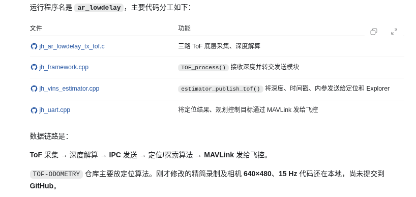
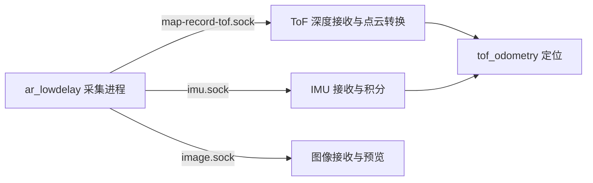
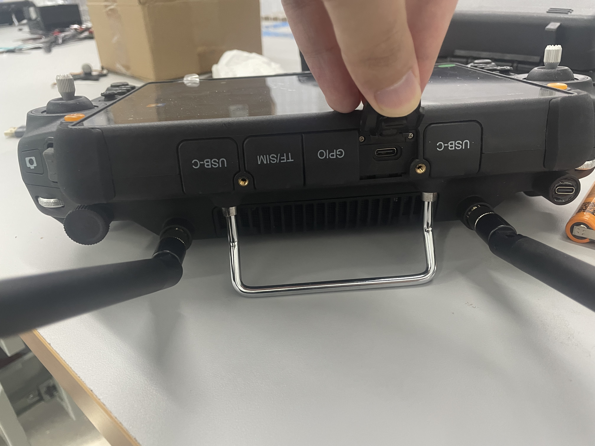
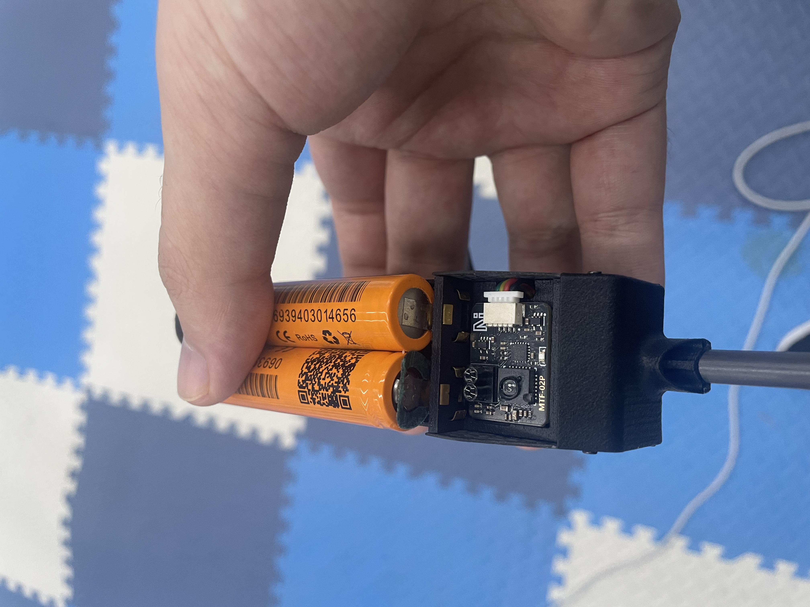
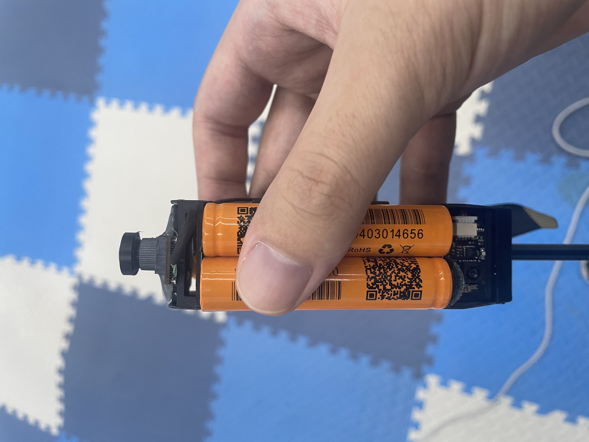
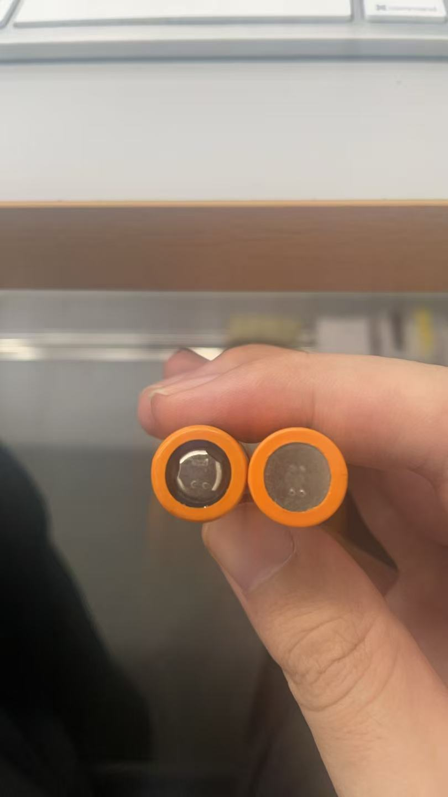
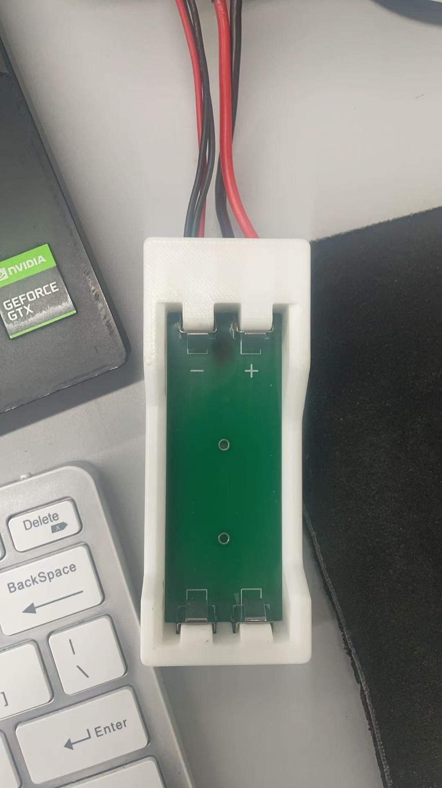

[TOC]

ubuntu 24.04复现NMI论文


# DiffPhysDrone 完整搭建文档（Ubuntu20.04 Docker容器）
> 目标：搭建可微分无人机仿真环境，编译自定义CUDA扩展 quadsim_cuda，成功运行单/多智能体训练
> 前置条件：宿主机已安装 docker + nvidia-container-toolkit，宿主机NVIDIA驱动支持CUDA11.8
> 容器名称：diffphysdrone

## 一、宿主机操作：拉取镜像 + 创建容器
宿主机终端执行
bash
docker pull ubuntu:20.04 # 拉取ubuntu20.04镜像


# 创建并启动容器，挂载源码、软件目录，开启GPU直通
docker run -it --gpus all \
-v /宿主机DiffPhysDrone源码路径:/workspace/DiffPhysDrone \
-v /宿主机software目录:/home/software \
--name diffphysdrone \
ubuntu:20.04 /bin/bash


### 再次进入容器（宿主机）


# 启动容器 + 交互式bash进入
docker start diffphysdrone && docker exec -it diffphysdrone /bin/bash
# 容器内退出：exit，仅退出shell，容器不停止
# ❌ 禁止 docker attach，Ctrl+C会直接杀死容器


## 二、容器内：基础系统依赖安装


apt update
apt install -y build-essential wget curl git


## 三、容器内：安装 Miniconda


# 下载安装脚本
wget https://repo.anaconda.com/miniconda/Miniconda3-latest-Linux-x86_64.sh
# 静默安装到 /opt/miniconda3
bash Miniconda3-latest-Linux-x86_64.sh -b -p /opt/miniconda3


## 四、创建 Python3.11 conda 环境


# 临时初始化conda
eval "$(/opt/miniconda3/bin/conda shell.bash hook)"
# 创建py311环境
conda create -n py311 python=3.11 -y
# 激活环境
conda activate py311


## 五、安装 CUDA Toolkit 11.8（仅 nvcc 编译工具，不装显卡驱动）

> 
> 驱动复用宿主机 NVIDIA 驱动


# cuda安装包放在挂载目录 /home/software
sh /home/software/cuda_11.8.0_520.61.02_linux.run --toolkit --silent --override


校验 nvcc


nvcc -V
# 预期输出 release 11.8, V11.8.89


## 六、写入～/.bashrc 自动加载环境（交互式终端自动配置）


cat >> ~/.bashrc <<'EOF'
# ===== Conda + CUDA + Torch lib auto setup for DiffPhysDrone =====
# only run for interactive shell
if [[ $- == *i* ]]; then
    # conda init
    eval "$(/opt/miniconda3/bin/conda shell.bash hook)"
    conda activate py311
    # CUDA Toolkit path
    export PATH=/usr/local/cuda-11.8/bin:$PATH
    export LD_LIBRARY_PATH=/usr/local/cuda-11.8/lib64:$LD_LIBRARY_PATH
    # Torch lib: fix custom cpp extension libc10.so missing
    export TORCH_LIB=/opt/miniconda3/envs/py311/lib/python3.11/site-packages/torch/lib
    export LD_LIBRARY_PATH="$TORCH_LIB:$LD_LIBRARY_PATH"
fi
EOF

source ~/.bashrc


## 七、安装 PyTorch 2.2.2+cu118


conda activate py311
pip install torch==2.2.2 --index-url https://download.pytorch.org/whl/cu118


校验 torch 与 GPU


python -c "import torch; print('torch:', torch.__version__, 'cuda:', torch.version.cuda, 'GPU available:', torch.cuda.is_available())"


### 修复 numpy 版本冲突（Torch2.2.2 仅支持 numpy1.x）


pip uninstall numpy -y
pip install "numpy<2.0"


## 八、编译 DiffPhysDrone 自定义 CUDA 扩展 quadsim_cuda

> 
> ⚠️ 必须加 --no-build-isolation，否则构建沙盒找不到 torch


cd /workspace/DiffPhysDrone
pip install -e src --no-build-isolation


✅ 成功标志：`Successfully built quadsim_cuda` + `Successfully installed quadsim_cuda-0.0.0`

验证扩展导入


python -c "import quadsim_cuda; print('quadsim_cuda loaded OK')"


## 九、安装项目运行依赖


pip install matplotlib tensorboard tqdm scipy gym


## 十、启动训练脚本


# 单智能体
python main_cuda.py $(cat configs/single_agent.args)

# 多智能体
python main_cuda.py $(cat configs/multi_agent.args)


> 
> 说明：`torch.cross without specifying the dim arg` 为弃用警告，不影响仿真计算，可忽略。

## 十一、后台长时间训练（防止 SSH 断开中断任务）


nohup python main_cuda.py $(cat configs/single_agent.args) > train_single.log 2>&1 &
# 实时查看日志
tail -f train_single.log


Tensorboard 可视化查看 loss 曲线


tensorboard --logdir=runs --bind_all


踩坑记录

1. CUDA run 安装：**只安装 toolkit，不要勾选 driver**，驱动使用宿主机驱动。
2. numpy>=2 与 torch2.2.2 存在 ABI 冲突，必须锁定`numpy<2.0`。
3. 编译 quadsim_cuda：缺少`--no-build-isolation`会报 ModuleNotFoundError: No module named 'torch'。
4. 导入扩展报错`libc10.so: cannot open shared object file`：conda activate 不会自动加载 torch/lib，需配置 LD_LIBRARY_PATH 写入 bashrc。
5. 不要使用`docker attach`进入容器，极易误按 Ctrl+C 杀死整个容器。
6. 环境变量放在`if [[ $- == *i* ]]`内，**仅交互式终端生效，后台训练脚本不受影响**。

# 环境版本清单

- 基础镜像：ubuntu:20.04
- Python：3.11
- CUDA Toolkit(nvcc)：11.8.89
- Pytorch：2.2.2+cu118
- Numpy：1.26.x
- 自定义 CUDA 扩展：quadsim_cuda


# 不是，**训练过程中就可以实时看曲线，不需要等全部训练结束**

TensorBoard 是**边训练边写日志**，每迭代若干步就把 loss 写入 `runs/` 目录，你随时可以打开网页查看。

## 操作步骤（容器内执行）


tensorboard --logdir=runs --bind_all


- `--bind_all`：允许宿主机浏览器访问（非常关键，不加只能容器内部访问）
- 启动后会输出地址，类似：`http://localhost:6006`

打开宿主机浏览器访问：


http://容器IP:6006


> 
> 如果是本地机器，容器 IP 可以用宿主机`localhost:6006`；远程服务器填服务器公网 IP:6006


宿主机终端执行（新开一个宿主机窗口！不要在正在跑训练的那个窗口输入）


docker exec -it diffphysdrone /bin/bash


### DiffPhysDrone 训练产出结果格式

1. 模型权重（最核心，用于断点续训、评估推理）

后缀：`.pth` / `.pt`，**PyTorch 标准序列化文件**

- 内部存储：网络权重、optimizer 状态、迭代次数、loss 记录等
- 读写方式：`torch.load()` / `torch.save()`
- 使用：`--resume xxx.pth` 加载做续训或者评估

> 
> 示例文件名：`model_50000.pth`，`ckpt_100000.pt`

2. TensorBoard 日志（loss 曲线数据）

存放目录：`runs/`，**不是图片，是一组 event 二进制文件**

- 文件名称类似：`events.out.tfevents.xxxx`
- 格式：TensorFlow protobuf 二进制日志
- 用途：TensorBoard 读取，绘制 loss、奖励等标量曲线
- 特点：不能直接双击打开；可以离线回看，也能用 python 脚本读取里面的标量数据导出 csv

 3. 文本日志（控制台输出）

- `train_single.log`：**纯文本 utf-8**
保存训练打印的 loss、迭代信息，可用`tail/grep`查看，可导出到 Excel 做离线绘图。

4. 评估输出（仅开启 eval/--eval_only 才会生成）

### 4.1 轨迹图片

`*.png` 静态图片（matplotlib 保存），**只有评估阶段才生成**，训练阶段默认没有。

### 4.2 仿真轨迹数据（可选，看代码实现）

很多时候代码会额外保存轨迹数值：

- `.npy`：numpy 二进制数组，存储无人机位置、速度、姿态时间序列，python 直接加载做后处理
- `.csv`：纯文本表格，位置 / 速度随时间，方便导入 matlab、excel 分析


### `checkpoint0000.pth` 就是训练保存的模型权重文件

> 
> 是 PyTorch 标准 ckpt，包含网络参数，一般还附带优化器状态、迭代计数，用来**断点续训**和**评估仿真**。

### 几个关键点

1. **文件名 `checkpoint0000.pth`**
0000 通常代表**初始保存 / 第 0 个断点**，要看日志确认它对应的迭代步数；
后面继续训练会陆续生成 `checkpoint0001.pth`、`checkpoint0002.pth`。
2. 验证这个文件能不能加载（评估 / 续训命令模板）


### 断点继续训练
python main_cuda.py $(cat configs/single_agent.args) --resume ./checkpoint0000.pth

### 仅评估，不训练，生成轨迹
python main_cuda.py $(cat configs/single_agent.args) --resume ./checkpoint0000.pth --eval_only

`checkpoint0001.pth` 是**在 0000 保存时刻的基础上，继续跑更多迭代之后，新保存的快照**。

可以，训练过程中支持做评估，两种方式

> 
> 评估 = 加载当前网络权重，跑仿真、算指标、生成轨迹图；**评估阶段不会更新网络参数，不会破坏训练**。


 GitHub Release 页面在哪里（网页端操作）

仓库地址：`https://github.com/JoeYao-bit/DiffPhysDrone`

1. 打开这个仓库主页
2. 页面右侧栏，找到 **Releases** 栏目（一般在 Star/Fork 下面），点进去就是 Release 页面
   - 分支`yz_20261014`只是代码分支，Release 是**整个仓库**的发布包，**不是在分支里面**
   - 很多人找不到：因为这个 fork 仓库**可能根本没有上传任何 Release 附件！**

> 
> 重点：`JoeYao-bit/DiffPhysDrone`是原作者的 fork 分支，**Release 在原始仓库 HenryHuYu/DiffPhysDrone**
> 原始仓库：[https://github.com/HenryHuYu/DiffPhysDrone](https://github.com/HenryHuYu/DiffPhysDrone)
> 👉 原始仓库右侧 Releases：[https://github.com/HenryHuYu/DiffPhysDrone/releases](https://github.com/HenryHuYu/DiffPhysDrone/releases)

> 
> 你 Readme 里面写的仿真验证包（LinuxNoEditor 虚幻引擎 Blocks.sh）是放在**原始仓库 Release 的附件**。

训练结果评估

Evaluation

You need to download the simulation validation code from the GitHub release page. To evaluate the trained model in multi-agent settings, use the following command to launch the simulator:

在<path to multi agent code supplementary>，

例如/home/yaozhuo/code/validation_code/swarm_v1/swarm/中运行脚本，唤起测试环境

cd <path to multi agent code supplementary>
./LinuxNoEditor/Blocks.sh -ResX=896 -ResY=504 -windowed -WinX=512 -WinY=304 -settings=$PWD/settings.json

测试指定模型(/home/yaozhuo/code/DiffPhysDrone/checkpoint0004.pth)

python eval.py --resume /home/yaozhuo/code/DiffPhysDrone/checkpoint0004.pth --target_speed 2.5


high_speed_flight_v1是告诉测试，需要20.04相关ros版本

swarm_v1是多个机器人测试，不需要两行命令就能跑：
./LinuxNoEditor/Blocks.sh -ResX=896 -ResY=504 -windowed -WinX=512 -WinY=304 -settings=$PWD/settings.json
(airsim_eval) ➜  swarm python eval.py --resume /home/yaozhuo/code/DiffPhysDrone/checkpoint0004.pth --target_speed 2.5


配置文件settings.json解析

{
  "SeeDocsAt": "https://github.com/Microsoft/AirSim/blob/main/docs/settings.md",
  "SettingsVersion": 1.2,       // AirSim配置文件版本号，固定1.2
  "LogMessagesVisible": false,  // 关闭仿真引擎内部日志输出，减少刷屏
  "SimMode": "Multirotor",      // 仿真模式：多旋翼无人机（不是汽车）
  "ViewMode": "Fpv",            // 默认主视图：FPV第一人称视角
  "ClockSpeed": 0.25,           // ⭐【非常关键】仿真时间缩放系数：0.25 = 仿真速度是真实世界的1/4，慢放仿真。
  // 比如真实1s，仿真只前进0.25s；用于给神经网络推理留出足够计算时间，防止推理延迟导致控制丢包。

  "CameraDefaults": {
    "CaptureSettings": [
      {
        "ImageType": 1,         // ImageType=1 = 灰度图(Grayscale)
        "Width": 48,
        "Height": 36,
        "FOV_Degrees": 79       // 视场角79°，小分辨率，是模型输入尺寸！DiffPhysDrone网络输入就是48×36灰度图
      },
      {
        "ImageType": 3,         // ImageType=3 = 深度图(DepthPerspective)
        "FOV_Degrees": 79
      }
    ]
  },

  "Vehicles": { // 定义所有无人机，一共6架 drone_1 ~ drone_6
    "drone_1": {
      "VehicleType": "SimpleFlight", // SimpleFlight：AirSim内置简化多旋翼动力学模型（DiffPhysDrone用这个）
      "Cameras": {
        "front_center_custom": { // 每架无人机挂载同一个名字的相机 front_center_custom
          "X": 0.25, "Y": 0.0, "Z": -0.1, // 相机在机体坐标系位置：机头向前0.25m，向下0.1m
          "Pitch": 10, "Roll": 0, "Yaw": 0 // 相机向下俯10°
        }
      },
      "X": 0, "Y": 0, "Z": 0, // 【注意】这里写的坐标只是默认值！
      "Pitch": 0, "Roll": 0, "Yaw": 0
    },
    // drone_2 ~ drone_6 和drone_1完全一致，6架无人机硬件/相机配置完全相同
  },

  "ExternalCameras": { // 全局外部相机，不属于任何无人机，鸟瞰俯视BEV
    "BEV": {
      "CaptureSettings": [{
        "ImageType": 0, // 0=RGB图
        "Width": 512,
        "Height": 288,
        "OrthoWidth": 8,
        "ProjectionMode": "orthographic" // ⭐正交投影鸟瞰图，没有透视变形，用于可视化全局多机位置
      }],
      "X": 3.0, "Y": 0.0, "Z": -6.0,    // 相机位置，高度6米俯视
      "Pitch": -90, "Roll": 0, "Yaw": -90 // 镜头垂直朝下
    }
  },

  "SubWindows": [ // 就是你截图里底部3个小预览窗口！对应界面的三色框
    {"WindowID": 0, "CameraName": "front_center_custom", "ImageType": 3, "VehicleName": "drone_2", "Visible": true, "External": false},
    // 窗口0：drone_2机载相机，深度图（ImageType3），截图里绿色框
    {"WindowID": 1, "CameraName": "BEV", "ImageType": 0, "VehicleName": "", "Visible": true, "External": true},
    // 窗口1：全局BEV鸟瞰RGB图，截图黄色框
    {"WindowID": 2, "CameraName": "front_center_custom", "ImageType": 3, "VehicleName": "drone_6", "Visible": true, "External": false}
    // 窗口2：drone_6机载相机，深度图，截图紫色框
  ]
}


## eval.py(网络测试脚本)解析


import argparse
from datetime import datetime
import json
import math
import os
import random
import signal
import subprocess
from time import sleep, time
import airsim
from airsim.types import Pose, Vector3r, Quaternionr
from airsim.types import AngleLevelControllerGains, PIDGains, AngleRateControllerGains
import numpy as np
from tqdm import tqdm

===================== 视频录制工具类：保存深度图可视化视频 =====================
class VideoRecorder:
    def __init__(self, output, w, h, fps=15, pix_fmt='rgb24') -> None:
        # ffmpeg子进程，用于把图像帧写入视频文件
        self.p = None
        self.output = output
        # 构造ffmpeg命令，从管道读取raw图像流编码成视频
        command = [
            "/usr/bin/ffmpeg",
            '-y',  # 覆盖已有输出文件，不弹窗询问
            '-f', 'rawvideo',
            '-vcodec','rawvideo',
            '-s', f'{w}x{h}',  # 单帧图像分辨率
            '-pix_fmt', pix_fmt,
            '-r', f'{fps}',  # 帧率
            '-i', '-',  # 输入来源：标准输入管道
            '-s', f'{w//2*2}x{h//2*2}',
            '-an',  # 不编码音频
            '-loglevel', 'error', # 只输出错误信息，屏蔽多余日志
            '-pix_fmt', 'yuv420p'
        ]
        self.p = subprocess.Popen(command + [self.output], stdin=subprocess.PIPE)

    def add_image(self, image):
        # 写入一帧图像到ffmpeg管道
        self.p.stdin.write(image)

    def close(self):
        # 关闭管道并等待ffmpeg完成编码
        if self.p is not None:
            self.p.stdin.close()
            self.p.wait()

===================== 定频控制器：维持固定循环频率 =====================
class Rate:
    def __init__(self, hz) -> None:
        self.hz = hz
        self.t0 = time()

    def sleep(self):
        # 计算需要sleep的时间，保证循环稳定hz频率
        while True:
            to_sleep = 1 / self.hz - time() + self.t0
            if to_sleep < 0.01:
                break
            sleep(to_sleep)
        self.t0 += max(1 / self.hz, 0.5 / self.hz - to_sleep)

===================== 模型与数学工具函数 =====================
import torch
import torch.nn.functional as F
from model import Model

def quaternion_to_matrix(quaternions: torch.Tensor) -> torch.Tensor:
    """
    四元数 -> 旋转矩阵，来自pytorch3d
    Args:
        quaternions: 实部在前的四元数 tensor(...,4)
    Returns:
        旋转矩阵 tensor(...,3,3)
    """
    r, i, j, k = torch.unbind(quaternions, -1)
    two_s = 2.0 / (quaternions * quaternions).sum(-1)
    o = torch.stack(
        (
            1 - two_s * (j * j + k * k),
            two_s * (i * j - k * r),
            two_s * (i * k + j * r),

            two_s * (i * j + k * r),
            1 - two_s * (i * i + k * k),
            two_s * (j * k - i * r),

            two_s * (i * k - j * r),
            two_s * (j * k + i * r),
            1 - two_s * (i * i + j * j),
        ),
        -1,
    )
    return o.reshape(quaternions.shape[:-1] + (3, 3))

===================== 命令行参数解析 =====================
parser = argparse.ArgumentParser()
parser.add_argument('--resume', default='exps/run1/checkpoint0004.pth', help="模型权重文件路径")
parser.add_argument('--env', default='swap', help="环境任务名称，当前只有swap场景")
parser.add_argument('--target_speed', default=2, type=float, help='m/s，无人机期望飞行速度上限')
parser.add_argument('--margin', default=0.15, type=float, help='m，机体安全半径，给网络作为避障安全距离输入')
parser.add_argument('--smoothness', default=0.5, type=float, help='平滑项参数(代码里未实际使用)')
parser.add_argument('--clockspeed', default=0.25, type=float, help='仿真时间缩放，必须和settings.json ClockSpeed保持一致')
parser.add_argument('--sr', default=3, type=int, help='下采样倍数，深度图降采样给神经网络输入')
parser.add_argument('--no_odom', default=False, action='store_true', help='是否关闭里程计输入，关闭则模型输入维度减少')
args = parser.parse_args()
print(args)

 悬停基准油门，SimpleFlight动力学悬停所需基础油门
hover_thr = 0.297
 hover_thr = 0.593

 创建本次评估的日志文件夹
datetime_str = datetime.now().strftime("%Y%m%d_%H%M%S")
log_dir = f'exps_{args.target_speed}/{datetime_str}/'
os.makedirs(log_dir)

 =====================【核心：任务定义，起点与目标航点】====================
 swap场景：列表内每个元组 (无人机名称, [起点,终点])
 坐标格式 [X,Y,Z] AirSim NED坐标系
 原版：左右两组无人机相向交叉飞行，swap交换位置，碰撞概率高
agents = {
"swap": [
        ("drone_1", [[ 0,  1.2, 0], [ 6, -1.2, 0]]),
        ("drone_2", [[ 0,  0.0, 0], [ 6,  0.0, 0]]),
        ("drone_3", [[ 0, -1.2, 0], [ 6,  1.2, 0]]),
        ("drone_4", [[ 6, -1.2, 0], [ 0,  1.2, 0]]),
        ("drone_5", [[ 6,  0.0, 0], [ 0,  0.0, 0]]),
        ("drone_6", [[ 6,  1.2, 0], [ 0, -1.2, 0]]),
    ],
}[args.env]

 深度图可视化视频保存器
depth_recorder = VideoRecorder(f'{log_dir}/depth.mp4', 16*args.sr, len(agents)*12*args.sr, pix_fmt='y8')

B = len(agents)  # B=6 无人机数量
agent_names, agent_waypoints = zip(*agents)
target_pos = [w[-1] for w in agent_waypoints] # 提取每架无人机最终目标终点

traj_history = {agent_name: [] for agent_name in agent_names} # 保存所有无人机轨迹，最后写入json

 连接AirSim仿真后端
client = airsim.MultirotorClient()
client.confirmConnection()
client.reset()

 模型加载到GPU
device = torch.device('cuda')
 模型输入维度：no_odom=7，带odom=10；输出6维动作
model = Model(7 if args.no_odom else 10, 6).eval().to(device)
if args.resume:
    model.load_state_dict(torch.load(args.resume, map_location=device))

@torch.no_grad()
def main():
    h = None
    # 预热模型，初始化LSTM/GRU隐藏状态
    for _ in range(10):
        _, _, h = model(
            torch.zeros(B, 1, 12, 16, device=device),
            torch.zeros(B, model.v_proj.in_features, device=device),
            h)
    sleep(1)
    # 初始化所有无人机：放置起点 + 设置初始机头yaw朝向目标 
    for agent_name, waypoints in agents:
        sleep(0.1)
        client.enableApiControl(True, agent_name)
        client.armDisarm(True, agent_name)
        client.moveByVelocityAsync(0, 0, 0, 0.5, vehicle_name=agent_name)
        # 计算初始yaw：机头预先对准【起点指向终点】的方向
        yaw = math.atan2(waypoints[1][1] - waypoints[0][1], waypoints[1][0] - waypoints[0][0])
        start_pt = waypoints.pop(0)
        # 在原始起点上增加小随机扰动，增加评估鲁棒性 ±0.1~±0.25
        start_pt = [
            start_pt[0] + random.random() * 0.2 - 0.1,
            start_pt[1] + random.random() * 0.2 - 0.1,
            start_pt[2] + random.random() * 0.5 - 0.25,
        ]
        # 把无人机放置到起点位置，忽略放置瞬间碰撞
        for _ in range(3):
            sleep(0.1)
            client.simSetVehiclePose(Pose(
                Vector3r(*start_pt),
                Quaternionr(0, 0, math.sin(yaw / 2), math.cos(yaw / 2))),
            ignore_collision=True, vehicle_name=agent_name)

        # 设置SimpleFlight多旋翼PID控制参数，对齐PX4风格
        client.setAngleRateControllerGains(AngleRateControllerGains(
            roll_gains=PIDGains(0.2, 0.01, 0.001),
            pitch_gains=PIDGains(0.2, 0.01, 0.001),
            yaw_gains=PIDGains(0.2, 0.01, 0.001),
        ))
        client.setAngleLevelControllerGains(AngleLevelControllerGains(
            roll_gains=PIDGains(2, 0, 0),
            pitch_gains=PIDGains(2, 0, 0),
            yaw_gains=PIDGains(2, 0, 0),
        ), agent_name)
    sleep(0.5)

    # 清空碰撞记录
    for agent_name, waypoints in agents:
        client.simGetCollisionInfo(agent_name)

    # 预分配张量存储状态
    p_target = torch.empty((B, 3)) # 每架无人机当前目标点坐标
    last_p = torch.empty((B, 3))   # 上一时刻位置
    forward_vec = torch.empty((B, 3))
    v = torch.empty((B, 3))       # 机体速度
    R = torch.empty((B, 3, 3))     # 世界->机体旋转矩阵

    traveled_distance = [0 for _ in agents] # 飞行总路程
    traveled_time = [0 for _ in agents]     # 任务耗时
    done_flag = [False for _ in agents]      # 是否到达目标标记
    has_collided = [set() for _ in agents]   # 碰撞记录集合

    extra = torch.tensor([[args.margin]]).repeat(B, 1) # 安全距离margin送入网络

    # 初始化每架无人机的第一个目标航点
    for i, (agent_name, waypoints) in enumerate(agents):
        x, y, z = waypoints.pop(0)
        p_target[i] = torch.as_tensor([x, -y, -z])
        # 获取初始位姿
        state = client.getMultirotorState(agent_name)
        q = state.kinematics_estimated.orientation
        p = state.kinematics_estimated.position
        q = torch.as_tensor([q.w_val, q.x_val, -q.y_val, -q.z_val])
        last_p[i] = torch.as_tensor([p.x_val, -p.y_val, -p.z_val])
        forward_vec[i] = quaternion_to_matrix(q)[:, 0]

    pbar = tqdm()
    hidden_state = None # 神经网络时序隐藏状态
    rate = Rate(15 * args.clockspeed) # 主循环频率 15Hz * 仿真时钟缩放
    t_begin_real = time()
    t_begin = state.timestamp / 1e9
    t_now = t_begin
    t_end = t_begin + 30 # 最大仿真时长30秒
    ctl_error = torch.randn((len(agents), 3)) * 0.17 # 控制扰动项

    # ====================== 主循环 15Hz 控制周期 ======================
    while t_now < t_end:
        pbar.update()
        # 读取每架无人机机载深度相机
        depth = []
        for agent in agent_names:
            responses = client.simGetImages([
                airsim.ImageRequest("front_center_custom", airsim.ImageType.DepthPlanar, True)
            ], agent)
            depth.append(airsim.get_pfm_array(responses[0]))
        depth = np.stack(depth)
        depth_viz = np.uint8(np.clip(depth / 10 * 255, 0, 255))
        depth_recorder.add_image(depth_viz.reshape(-1, 16*args.sr))

        # 读取所有无人机状态、更新轨迹记录
        for i, (agent_name, waypoints) in enumerate(agents):
            state = client.getMultirotorState(agent_name)
            t_now = state.timestamp / 1e9
            p = state.kinematics_estimated.position
            q = state.kinematics_estimated.orientation
            _v = state.kinematics_estimated.linear_velocity
            traj_history[agent_name].append([p.x_val, p.y_val, p.z_val, q.w_val, q.x_val, q.y_val, q.z_val])

            # 坐标转换，存入tensor
            p = torch.as_tensor([p.x_val, -p.y_val, -p.z_val])
            duration = t_now - t_begin
            if not done_flag[i]:
                traveled_distance[i] += torch.norm(p - last_p[i]).item()
                traveled_time[i] = duration
            last_p[i] = p
            v[i] = torch.as_tensor([_v.x_val, -_v.y_val, -_v.z_val])
            q = torch.as_tensor([q.w_val, q.x_val, -q.y_val, -q.z_val])
            R[i] = quaternion_to_matrix(q)

            # 判断是否到达当前目标点：距离<1.5m判定到达
            if not done_flag[i] and torch.norm(p_target[i] - p) < 1.5:
                if waypoints:
                    # 还有后续航点，切换到下一个目标
                    x, y, z = waypoints.pop(0)
                    p_target[i] = torch.as_tensor([x, -y, -z])
                else:
                    # 所有航点跑完，任务完成
                    print(f"{agent_names[i]} arrived in {duration}s!")
                    done_flag[i] = True
                    client.moveToPositionAsync(*target_pos[i], 0.5, vehicle_name=agent_names[i])
                    # 全部无人机到达，提前结束仿真
                    if all(done_flag):
                        t_end = t_now + 0.5

        # 计算目标速度向量：从当前位置指向目标点，限制最大速度target_speed
        target_v = p_target - last_p
        target_v_norm = torch.norm(target_v, 2, -1, keepdim=True)
        target_v = target_v / target_v_norm * target_v_norm.clamp_max(args.target_speed)

        # 姿态矩阵预处理，投影到水平面（忽略高度，只保留水平前向）
        env_R = R.clone()
        fwd = R[:, :, 0].clone()
        up = torch.zeros_like(fwd)
        fwd[:, 2] = 0
        up[:, 2] = 1
        fwd = fwd / torch.norm(fwd, 2, -1, keepdim=True)
        R = torch.stack([fwd, torch.cross(up, fwd), up], -1)

        # 组装网络输入状态：机体速度、目标速度、旋转矩阵、安全margin
        state = [torch.squeeze(target_v[:, None] @ R, 1), R[:, 2], extra]
        local_v = torch.squeeze(v[:, None] @ R, 1)
        if not args.no_odom:
            state.insert(0, local_v)
        state = torch.cat(state, -1)

        # 深度图预处理与下采样
        depth = torch.as_tensor(depth, device=device)[:, None]
        x = 3 / depth.clamp_(0.3, 24) - 0.6
        x = F.max_pool2d(x, (args.sr, args.sr))

        # 神经网络前向推理，输出控制action
        state = state.to(device)
        action, _, hidden_state = model(x, state, hidden_state)

        # 将机体局部坐标系action转换为世界坐标系加速度指令
        v_setpoint, v_est = (R @ action.cpu().reshape(B, 3, -1)).unbind(-1)
        a_setpoint = v_setpoint - v_est + ctl_error
        a_setpoint[:, 2] += 9.80665 # 补偿重力

        # 加速度 -> 期望姿态角 + 油门
        throttle = torch.norm(a_setpoint, 2, -1)
        up_vec = a_setpoint / throttle[..., None]
        throttle = throttle + local_v[:, 2] * local_v[:, 2].abs() * 0.01

        # 计算期望roll/pitch/yaw
        forward_vec = env_R[..., 0] * 5 + p_target - last_p
        forward_vec[:, 2] = (forward_vec[:, 0] * up_vec[:, 0] + forward_vec[:, 1] * up_vec[:, 1]) / -up_vec[:, 2]
        forward_vec /= torch.norm(forward_vec, 2, -1, True)
        left_vec = torch.cross(up_vec, forward_vec)
        roll = torch.atan2(left_vec[:, 2], up_vec[:, 2])
        pitch = torch.asin(-forward_vec[:, 2])
        yaw = torch.atan2(forward_vec[:, 1], forward_vec[:, 0])

        # 下发roll/pitch/yaw/throttle指令到AirSim
        for i, (r, p, y, t) in enumerate(zip(roll.tolist(), pitch.tolist(), yaw.tolist(), throttle.tolist())):
            if done_flag[i]:
                continue
            t = t / 9.8 * hover_thr
            client.moveByRollPitchYawThrottleAsync(r, p, y, t, 0.5, agent_names[i])
            # 碰撞检测
            collision_info = client.simGetCollisionInfo(agent_names[i])
            if collision_info.has_collided:
                has_collided[i].add(collision_info.object_name)
                print(f"{agent_names[i]} collide with {collision_info.object_name}!")

        # 维持循环频率
        clockspeed = duration / (time() - t_begin_real)
        rate.hz = 15 * clockspeed
        rate.sleep()

    # 保存评估日志文本
    with open(f"{log_dir}/log", 'w') as f:
        f.write(f'{args}\n')
        for i, (x, t) in enumerate(zip(traveled_distance, traveled_time)):
            f.write(f'ours,{args.env},{args.target_speed},{agent_names[i]},{x:.2f},{t:.2f},0,{done_flag[i]},{"_".join(has_collided[i])}\n')

if __name__ == '__main__':
    import shutil
    # 备份本次eval.py到日志目录，方便复现
    shutil.copy(__file__, f"{log_dir}/eval.py")

    # ========== 全局画面录屏（x11grab，无桌面环境会报错，不影响评估 ==========
    # 如果你不需要录屏，可以直接注释掉下面这一段ffmpeg启动代码
    ffmpeg_p = subprocess.Popen([
        '/usr/bin/ffmpeg',
        '-f', 'x11grab',
        '-video_size', '896x504',
        '-i', ':0+512,340',
        '-c:v', 'h264_nvenc',
        '-vf', f'setpts={args.clockspeed}*PTS',
        '-loglevel', 'error',
        '-an',
        f'{log_dir}/{datetime_str}.mp4'
    ], stdin=subprocess.PIPE)

    def cleanup():
        # 程序退出时执行：保存轨迹json，关闭视频录制
        with open(f"{log_dir}/traj_history.json", 'w') as f:
            json.dump(traj_history, f)
        ffmpeg_p.stdin.close()
        ffmpeg_p.wait()
        depth_recorder.close()
        print("start recording")
    try:
        main()
        ffmpeg_p.send_signal(signal.SIGINT)
    finally:
        cleanup()


### 测试日志保存目录
测试视频按照时间记录在swarm下面的文件夹：

/home/yaozhuo/code/validation_code/swarm_v1/swarm/exps_2.5/


### 如何控制无人机前往何方？

eval.py中根据当前位置到目标位置的向量夹角，计算出一个相对速度target_v，作为目标参考输入网络

这个参考速度每一帧都计算


### 是否有最低高度限制远离地面？

**在 DiffPhysDrone 这个 eval + 模型原生设计里：网络本身不会显式读取最低高度、不会内置 “远离地面” 的硬约束。**
高度相关行为，来自两处：**深度图观测 + 训练损失函数**，不是代码里写死的高度阈值。

1. 网络能看到什么高度信息

网络输入是**机载深度图**，深度图包含向下方向的距离（地面距离）。

- 当无人机离地面很近，深度图底部区域会出现很小的深度值；
- 网络从深度图像像素中**隐式感知地面**；
- 网络**没有单独输入一个 “当前离地高度” 标量**，也没有传入最小安全高度参数作为独立输入。

> 
> 对比：`target_v_body` 是目标方向参考速度；`margin` 是障碍物安全半径（用于周围物体，**不是地面高度**）。

2. 训练阶段怎么让它不撞地

训练的损失函数里会包含**撞地惩罚项**：

- 如果仿真中无人机高度过低、接触地面，会产生很大的损失；
- 网络学习：**看到下方地面很近，就要向上调整输出的 v_set 速度，抬高高度**。

⚠️ 重点：这是**学习出来的行为，不是硬约束**。
如果遇到训练分布以外的场景（陡峭地形、地面突然凹陷），模型依然有可能下冲撞地。
eval 脚本**没有任何代码做高度保护**，不会强制限制最低高度。

3. 区分两个东西

1. **硬高度保护（工程常用）**
eval 里加一行判断：如果 z 高度 < 0.5m，直接强制向上速度。
→ 这个**当前 eval 脚本不存在**，需要你自己额外写。
2. **模型隐式避地（DiffPhysDrone 原生）**
靠深度图 + 训练撞地损失，学会远离地面；
本质和避开前方障碍物是同一套机制，**没有单独的高度指标**。


### 能不能完全避开障碍物？

**一定会存在避让失败概率，不是 100% 成功**

DiffPhysDrone 这种基于视觉 + 可微物理学习的端到端避障，本质是**统计学习模型**，不是完备的几何避障规划器（比如 RRT、APF），存在失败场景。

一、失败的根源

1. **训练分布局限性**
网络只见过训练集里的障碍物形态、相对速度、场景。

- 在**训练分布内**：成功率很高；
- **分布外 OOD 场景**：陌生障碍物、极窄通道、高速相向碰撞、薄细线障碍物、突然出现物体，失败概率明显上升。

2. **观测存在延迟 + 感知局限**
依靠单目深度图：

- 远距离深度噪声大；
- 细小物体（电线、细杆）容易漏检；
- 相机视场外的障碍物完全看不到（盲区，无法避让）。

> 
> 它只能避开**已经出现在深度图里**的东西。侧面 / 后方不在相机 FOV 的障碍物，模型不知道。

3. **动力学滞后**
无人机本身是二阶动力学系统，有惯性。
如果障碍物离得过近、相对速度很大，哪怕网络识别出来，**动力学来不及减速 / 机动，依然碰撞**。
4. **没有全局规划，是局部反应式避障**
网络只拿到当前深度图 + 指向目标的参考速度 `target_v_body`。
它是**局部反应式控制器**，不会提前规划长路径。
会出现典型失效：局部陷入死胡同、卡在凹形障碍物里、进入死局。

二、常见的失败模式（你在 eval 仿真里很容易复现）

1. 高速相向飞行，来不及减速碰撞；
2. 很细的立柱，深度图感知弱，直接撞上；
3. U 型凹槽，模型冲进去之后无路可走，卡住或者撞墙；
4. 光照 / 深度噪声造成误感知，误判障碍物距离；
5. 高度方向失效：对地面 / 台阶感知不足，撞地。

三、和传统避障算法对比

- 传统规划（RRT*、MPC 避障）：几何判断，只要传感器准确，在约束内是确定性的；但计算开销大，依赖状态估计。
- DiffPhysDrone 端到端网络：**轻量、直接输出速度指令，但具备随机失败概率**，成功率和场景、速度强相关。

> 
> 论文里给的成功率，都是**特定场景、特定速度下的统计值**，不是 100%。速度越高，失败概率越高。

四、怎么量化这个失败概率（你在 eval 中就能做）

你可以批量跑多次 eval，统计指标：

1. 到达目标的成功率（到达目标 / 总试验次数）
2. 碰撞率（发生障碍物 / 地面碰撞 / 总试验次数）
3. 超时失败（30s 内无法抵达目标）

简单思路：写循环脚本，多次随机初始扰动，统计碰撞次数。

五、降低失败概率的两种方案

1. **模型层面**：扩充训练集，增加更多障碍物、速度分布，增强 OOD 泛化（需要重新训练）
2. **外部兜底（推荐，不改网络）**：在 eval 上加安全保护层
   - 最小离地高度保护；
   - 最小障碍物距离检测：深度图最近点小于阈值，强制减速 / 向上 / 侧向避让；
   - 超时判定，卡住直接终止 episode。

> 
> 重点：**安全兜底是独立于神经网络的，就算网络推理出错，也能阻止碰撞**。

20261016

接下来搭建一个单机多障碍的测试环境，无人机慢速追踪某个慢速移动目标


### 仿真环境文件

/home/yaozhuo/code/validation_code/swarm_v1/swarm/LinuxNoEditor/Scaffold/Binaries/Linux/Blocks

二进制地图文件

由文件./LinuxNoEditor/Blocks.sh 加载

Ubuntu 不能做：UE 关卡可视化编辑（删除 Blocks 自带墙体）


### AirSim环境文件下载地址

https://github.com/microsoft/AirSim/releases


## 加载足球场环境成功

cd /home/yaozhuo/code/validation_code/MSBuild2018(soccer_filed)/


./LinuxNoEditor/MSBuild2018.sh -ResX=896 -ResY=504 -windowed -WinX=512 -WinY=304 -settings=$PWD/settings.json


探索仿界面如何视角可调，鼠标可见


### 仿真界面解决两个问题：**视角固定 + 鼠标消失**

根源：`settings.json`里的`ViewMode`默认是`FlyWithMe`（跟随无人机，视角锁死），虚幻引擎窗口会捕获鼠标，导致看不见光标。

> 
> ⚠️ 重点：**不用改启动 sh 命令，修改 settings.json**，你的 eval、动态生成圆柱代码完全不变。

 1. 修改 settings.json，开启手动自由视角

创建 / 修改你的`settings.json`，核心是设置`"ViewMode":"Manual"`。

```
{
    "SettingsVersion": 1.2,
    "SimMode": "Multirotor",
    "ViewMode": "Manual"
}
```

- `"ViewMode":"Manual"` = 相机不再自动跟随无人机，**WASD 移动相机，鼠标旋转视角**，自由漫游场景Microsoft ...
- 键盘快捷键（Manual 模式）：
  - `W/A/S/D`：前后左右移动相机
  - `Q/E`：上升 / 下降
  - 鼠标拖动：旋转视角
  - `F1`：查看全部快捷键帮助

> 
> 注意：AirSim 加载顺序：优先读取命令行`-settings=`指定的 json，所以你启动命令里`-settings=$PWD/settings.json`是生效的。

 2. 鼠标看不见的问题（Unreal 引擎特性）

AirSim 的虚幻打包程序默认**捕获鼠标，隐藏系统光标**，这是 UE4 独立打包程序的固有行为，分 2 种情况：

1. **窗口激活时：鼠标被捕获，看不到光标，但是移动鼠标可以旋转视角（Manual 模式）**
   - 想临时释放鼠标：**Alt+Tab 切到别的窗口，鼠标就恢复显示**；切回仿真窗口会再次捕获。
2. 无法永久在仿真窗口内显示鼠标（**预编译打包的 AirSim 环境无法修改 UE 引擎输入设置，只有源码编译才能关闭鼠标捕获**）。

> 
> ✅ 不影响你：虽然看不到光标，**鼠标移动依然可以转动相机视角**，这是最关键的。


DiffPhysDrone（论文 *Learning vision-based agile flight via differentiable physics*）采用的就是**零样本迁移（zero-shot sim-to-real transfer）**。

**系统辨识【不需要改动 pth 网络权重文件】，完全不动`.pth`。**

区分两件东西

1. **网络权重（pth 文件）**：深度图 → 期望加速度的神经网络，**辨识全程不修改它**，零样本迁移的核心就是 pth 保持原样。
2. **动力学模型参数**（不是网络参数！）：`hover_thr`、阻力系数 drag、控制延迟 τ、推力滞后等。
   - 系统辨识干的事：采集真机 IMU / 姿态数据，**优化这一组动力学参数**，替换到 DiffPhysDrone 的**可微物理模拟器**里；
   - 神经网络本身的权重、网络结构一丝不改，`.pth`文件不变
  

###  Dajun文件解析

####  export_policy.py

核心逻辑简要解读

1. **设计目的**
不使用 TorchScript / ONNX。机载飞控侧只有纯 C 代码，没有 PyTorch/ONNX Runtime。网络规模很小，手写 C 前向推理，直接加载扁平化二进制权重文件，开销最小。
2. **文件结构 policy.bin**

```
固定Header(魔数、版本、模型超参)
→ 逐个张量元信息：维度数+shape
→ 依次写入全部权重：float32小端序，顺序严格按照MANIFEST
```

> 
> C 端**按顺序读，不按名字查找张量**，所以 MANIFEST 顺序绝对不能随便调换。

3. **--testvec 的作用（非常关键）**
导出一组固定输入 + PyTorch 的标准答案输出。
机载 C 程序上电自动跑这个测试样例；一旦结果对不上，直接判定 C 前向代码存在 bug，**禁止起飞**。用来防范算子手写错误、权重读取字节序错误。
4. 适配 DDP 训练的 ckpt：自动剔除`module.`前缀。

#### 对应你真机部署的重点

- 这个脚本就是**把 pth 转为机载 C 运行时能直接加载的二进制权重**；**不修改网络本身权重数值**，只是序列化格式转换，零样本迁移流程里导出这一步不会改变策略。
- 导出后，C 侧必须**完全复现 PyTorch 所有算子（Conv、GRU、Linear）**，`testvec`就是用来验证算子实现一致性。
- 一旦修改模型结构、增减层，需要同步更新 MANIFEST 并且升级 VERSION，否则 C 端加载张量错位。

#### helicopter_control.py

###### 整体核心解读

> 
> 这是**DiffPhysDrone 真机部署前端预处理 + 坐标变换 + 控制积分器**，衔接：传感器输入 → 网络推理 → 飞控 ArduPilot。
> 核心痛点：**仿真使用 FLU 机体坐标系；ArduPilot 飞控标准是 FRD 机体坐标系，导航 NED 坐标系**，两套框架坐标系定义不一样，必须显式转换，否则飞机会反向运动、炸机。

##### 4 个核心函数拆解

1. **prepare_dual_flow()**
把机载相机原始光流图，做缩放、裁剪、拼接，归一化成网络要求的 `B×4×12×16` 输入。
双分支：全图光流 + 图像中心区域光流，合并为 4 通道，和仿真训练输入保持完全一致。
2. **prepare_tof()**
三路 ToF 深度相机（前、左、右）原始测距（米），归一化编码成 `B×3×30×30`。

> 
> 规则：近距离 =+1，远距离 / 无回波 =-1；**通道顺序不能乱 front/left/right**，和仿真 render_tof 完全对齐。
3. **policy_acceleration()**
网络输出 6 维向量解码：前 3 维是机体 FLU 坐标系期望加速度，后 3 维是预测速度。tanh 把加速度限幅。

> 
> 网络输出不是直接给飞控的 PWM，是**期望机体加速度**。
4. **yaw_only_rotation_frd_to_ned()**
只使用 yaw（偏航角）构造旋转矩阵，**忽略 roll/pitch**。

> 
> 论文仿真训练就是这么做的，这是非常重要的细节：
> 如果使用完整姿态 DCM（包含横滚俯仰），无人机倾斜时机体→世界坐标转换会引入额外误差，策略失效。

##### AccelerationVelocityIntegrator 类（控制积分器，部署核心）

作用：把网络输出的**期望加速度**，积分成 ArduPilot 可以接收的 **NED 坐标系速度指令 + 目标 yaw**。
流程：

1. 坐标系转换 FLU → FRD → NED；
2. 加速度积分，更新 NED 速度；
3. 在机体 FLU 坐标系对速度硬限幅（前向最大 3m/s，其余 ±1m/s，和仿真约束一致）；
4. 融合当前机头朝向与期望速度方向，输出目标偏航，抑制悬停 yaw 抖动；
5. 返回 NED 速度 + 目标 yaw，发给 ArduPilot 飞控。

真机部署重点坑（你需要重点关注）

1. **坐标系符号**：FLU (前左↑) ↔ FRD (前右↓)，左右、上下轴取反，一旦符号写错飞机反向飞。
2. **yaw-only 旋转**，不能用完整姿态矩阵。
3. 预处理逻辑（光流 / ToF 归一化、裁剪、缩放）必须和仿真`env_cuda.py`完全一致，否则输入分布偏移，零样本迁移失效。
4. 速度限幅是**机体坐标系限幅**，不是世界坐标系。
5. 不要在代码里额外平滑 yaw_target；ArduPilot 飞控内环自带滞后，额外平滑会造成双重延迟，和仿真动力学不一致。

数据流完整链路（结合前面的 export_policy.py）

```
ToF相机+光流相机 → prepare_tof() + prepare_dual_flow() → 网络输入
→ 推理（C runtime加载policy.bin）→ policy_acceleration解码FLU加速度
→ AccelerationVelocityIntegrator积分+坐标变换 → NED速度指令 + yaw_target
→ 下发给ArduPilot飞控
```

20261020
### 20261020 

目前跟踪目标主要是人

小直飞控还没调试好，暂时无法进行实物测试

目标识别基于武松的yolo开发，rgb相机图像中识别出目标像素坐标

深度信息由tof相机提供，但二者尚未建立对应关系，无法得知rgb图像的像素坐标对应的深度

考虑到DiffPhysDrone项目需要输入指向目标的速度作为参考

可以直接目标框在视觉图像上像素坐标生成参考深度，比如框中心在左侧则往左飞，否则往右飞，在中间则往前飞

是否到达目标附近可以参考头部（大小相对固定）

缺点：会高估前后方向的空间。人头前后更长，基于头部宽度在画面中的大小判断是否到达因为人头部前后宽度大于左右宽度误差较大

如果引入追逐假设，即人在前面走，无人机在后面追，则画面中看到的头部宽度是左右宽度，不同年龄性别下相对固定，误差较小


大军给的文档：

### **ToF 采集、发送程序**在这个仓库：

**[xiaopixiong/xiaozhi-ar-lowdelay](https://github.com/xiaopixiong/xiaozhi-ar-lowdelay)**

运行程序名是 **`ar_lowdelay`**，主要代码分工如下：

| 文件 | 功能 |
|---|---|
| [jh_ar_lowdelay_tx_tof.c](https://github.com/xiaopixiong/xiaozhi-ar-lowdelay/blob/master/platform/src/jh_ar_lowdelay_tx_tof.c) | 三路 ToF 底层采集、深度解算 |
| [jh_framework.cpp](https://github.com/xiaopixiong/xiaozhi-ar-lowdelay/blob/master/jh_framework/jh_src/jh_framework.cpp) | `TOF_process()` 接收深度并转交发送模块 |
| [jh_vins_estimator.cpp](https://github.com/xiaopixiong/xiaozhi-ar-lowdelay/blob/master/jh_framework/jh_src/jh_vins_estimator.cpp) | `estimator_publish_tof()` 将深度、时间戳、内参发送给定位和 Explorer |
| [jh_uart.cpp](https://github.com/xiaopixiong/xiaozhi-ar-lowdelay/blob/master/jh_framework/jh_src/jh_uart.cpp) | 将定位结果、规划控制目标通过 MAVLink 发给飞控 |

数据链路是：

**ToF 采集 → 深度解算 → IPC 发送 → 定位/探索算法 → MAVLink 发给飞控。**

`TOF-ODOMETRY` 仓库主要放定位算法。**刚才修改的精简录制及相机 640×480、15 Hz 代码还在本地，尚未提交到 GitHub。**




当前 YOLO 集成在 **`ar_lowdelay` 采集程序内部**，通过配置开关启动，不需要另外运行一个 YOLO 程序。虽然文件名叫 `jh_yolov5.cpp`，实际加载的是 **YOLOv8 模型**。

**1．连接算力板，确认模型文件存在**

```bash
ssh -i ~/.ssh/uav_explorer root@192.168.3.100
```

在板端执行：

```bash
ls -lh /usrdata/param/testkit-1.json \
       /usrdata/param/YOLOv8sDet_opt.npubin
```

缺少文件时，需要先上传对应模型和配置。

**2．开启检测**

修改板端 `/usrdata/uav/capture/config/capture.json`：

```json
"is_yolo_enable": true,
"yolo_intervel": 15
```

也可以执行以下命令备份并开启：

```bash
cp -p /usrdata/uav/capture/config/capture.json \
      /usrdata/uav/capture/config/capture.json.before-yolo

sed -i 's/"is_yolo_enable"[[:space:]]*:[[:space:]]*false/"is_yolo_enable":true/' \
    /usrdata/uav/capture/config/capture.json
```

`yolo_intervel=15` 表示**每15帧检测一次**，不是15 Hz。如果相机输入30 Hz，检测频率约为2 Hz，与刚才设置的图像录制15 Hz是独立的。

**3．重启并检查**

这个开关在程序初始化时读取。**无人机落地、未解锁后**执行：

```bash
reboot
```

重新连接后查看：

```bash
tail -f /mnt/uav-logs/capture.log
```

出现 `yolov5 out , process cost` 表示已经执行推理；有目标时会打印检测框和置信度。仅出现 `yolov5 init sucess` 还不能证明推理正常。

当前模型配置还设置了 `"allowed_classes": [0]`，即仅保留类别0的检测结果。

---------------------------------------------

### **`ar_lowdelay` 与 `tof_odometry` 通过算力板上的 Unix 域 socket 通信，默认目录是 `/tmp/uav-ipc/`。**

Unix 域 socket 通信是本地进程间通信（IPC）的一种套接字，不走网络协议栈、不走网卡，只在同一台主机内部进程之间传数据；和 TCP/IP socket API 几乎一样，但是地址不是 IP + 端口，而是文件系统上的一个路径名

**当前基线服务已经接收图像，但图像只用于预览，没有参与 ICP／ESKF 定位。**



**1. 发送端主要看这个文件**

[jh_vins_estimator.cpp](/media/daotong/30201387201353683/UAV/xiaozhi/ars45-c402-evb-0.17.83-00-20250904_jh20260915/base/customer/apps/ar_lowdelay/jh_framework/jh_src/jh_vins_estimator.cpp:17)

虽然名字中有 `vins_estimator`，这里主要负责**把采集数据打包发送出去**。

| 函数及行号 | 发送内容 | 目的 socket |
|---|---|---|
| `estimator_publish_tof()`，95 行 | 三路 ToF 深度、内参、时间戳、传感器编号 | `tof.sock` 和 `map-record-tof.sock` |
| `estimator_publish_image()`，42 行 | 实时灰度图，480×360，约 10 Hz 上限 | `image.sock` |
| `estimator_imu_init()`，74 行 | 加速度、角速度及时间戳 | `imu.sock` |
| `publish_calibration_image()`，17 行 | 原生 640×480 灰度图，目标 15 Hz，用于录制／标定 | `calibration-image.sock` |

这里要区分：**你要求的 640×480、15 Hz 是录制／标定分支；实时定位服务目前接收的仍是另一路 480×360 图像。**

ToF 发送的关键代码是：

```cpp
// 发给 Explorer
tx.send("tof.sock", h, payload.data(), payload.size());

// 发给 ToF 定位接收端，目的 socket 存在时发送
record_tx.send("map-record-tof.sock",
               h, payload.data(), payload.size());
```

虽然名字叫 `map-record-tof.sock`，当前基线定位服务实际就是从这里接收 ToF。

发送的是 **210×160 的厂商 uint16 深度容器**，附带内参；不是发送端已经算好的三维点云，也不代表有 210×160 个独立有效测距点。

**2. 采集回调怎样调用发送函数？**

在 [jh_framework.cpp](/media/daotong/30201387201353683/UAV/xiaozhi/ars45-c402-evb-0.17.83-00-20250904_jh20260915/base/customer/apps/ar_lowdelay/jh_framework/jh_src/jh_framework.cpp:266)：

```cpp
// 相机回调：266 行附近
RGB_640_480_process(...)
    → estimator_publish_image(...)

// ToF 回调：450 行附近
TOF_process(...)
    → estimator_publish_tof(...)
```

ToF 更上游的深度处理入口在 [jh_ar_lowdelay_tx_tof.c:1447](/media/daotong/30201387201353683/UAV/xiaozhi/ars45-c402-evb-0.17.83-00-20250904_jh20260915/base/customer/apps/ar_lowdelay/platform/src/jh_ar_lowdelay_tx_tof.c:1447)：先进行深度图方向校正，再调用 `TOF_process()`，传入 SDK 的 `u64MNPTS` 时间戳。

**3. `tof_odometry` 在哪里接收？**

主要看 [baseline_service.cpp:31](/media/daotong/30201387201353683/UAV/xiaozhi/tof_odometry/live/baseline_service.cpp:31)：

```cpp
uav::Receiver tof("map-record-tof.sock");
uav::Receiver image("image.sock", ...);
ImuInbox imu;  // 默认接收 imu.sock
```

主循环在 63 行附近接收、检查消息，再分别处理：

| 数据 | 后续处理 |
|---|---|
| ToF | 78 行调用 `g.project()`，转换成点云，放入对应传感器队列 |
| IMU | 74 行读取加速度和角速度，推进姿态估计；另有异步接收与传播 |
| 图像 | 80 行缩小图像，通过 `VINS_IMAGE` 发送诊断预览 |

深度转点云的实现位于 [sensors.hpp:22](/media/daotong/30201387201353683/UAV/xiaozhi/tof_odometry/live/sensors.hpp:22) 的 `Geometry::project()`。

**4. socket 通信本身在哪里实现？**

在共享库 [uav_ipc.hpp:114](/media/daotong/30201387201353683/UAV/xiaozhi/uav_ipc/include/uav_ipc.hpp:114)：

- `Sender::send()`：用非阻塞 `sendmsg()` 发送消息头和数据；
- `Receiver::receive()`：用 `recv()` 接收并校验消息；
- 消息头包含类型、时间戳、序号、传感器编号、图像宽高；
- 发送失败会累计丢包计数，不能把“调用了发送函数”等同于接收成功。

**如果下一步接入 FAST-LIVO2 式视觉融合，重点改的是接收后的图像处理链路。** 目前数据已经能送到 `baseline_service.cpp`，但还需要增加视觉地图点、参考图像块、图像匹配和视觉残差更新，才算真正让图像参与定位。

### 技术问题讨论记录

武松：目标离飞机的距离怎么判断呢？
yz:有两个思路，一个是比较完善的思路，关联rgb图像和tof图像，得到rgd像素对应的深度，然后得到相对位姿包括距离
还有一种比较取巧的思路，人体轮廓比如头部宽度相对固定，可以提前采集不同距离下人体头部在rgb相机上的像素框宽yz:度，使用时根据像素框宽度查表插值得到近似的距离
第一种理论上限更高，但开发比较复杂，因为rgb相机和tof相机所拍摄的区域并不完全一致，因此rgb图像中的像素框可能超出tof拍摄的范围，导致无法获得深度；以及不同相机参数想让像素对应需要标定
第二种开发简单很多，但是精确性可能不够，因为人体姿态可能会倾斜导致像素框宽度变大；以及如果后续换成人以外的其他跟踪对象这套方法就不好用了
武松：我觉得两种方案可以一起用，深度点云里能找到目标就用点云深度，找不到就用头部宽度预估

武松：tof的fov是60*45°（大军：30*30像素，900个点），RGB是152×129°，深度图找不到目标的可能性还挺大的，我觉得两种方案可以一起用，深度点云里能找到目标就用点云深度，找不到就用头部宽度预估

yz:好的，目前我想到的办法是假设目标被遮挡后仍留在消失前的位置，然后控制无人机飞到这个位置，如果重新看到目标则继续跟踪，否则停在这个位置

武松：我觉得可以


### 关键仓库

大军维护的修改过的DiffPhysDrone项目仓库：
https://github.com/xiaopixiong/HenryHuYu-DiffPhysDrone-0915

大军的ToF采集发送仓库：

https://github.com/xiaopixiong/xiaozhi-ar-lowdelay

DiffPhysDrone采用图像是16 × 12大小，
为什么分辨率固定

- CNN 卷积层权重是在 12×16 尺寸上训练收敛的；
- 网络的输入张量 shape 硬编码；**推理时如果尺寸不对，无法前向传播，pth 权重不能直接使用**；
- 主论文正文和附录都明确：训练、仿真评估、真机部署，**预处理链路完全一致，保证 sim-to-real 迁移**

接下来计划

跑通获取原始ToF图像

跑通获取yolo8检测人体结果，得到人对应的图像框，以及了解是否可以头部检测


头部检测需要左右耳或者左右瞳孔间距，

或者使用肩宽更加稳定（指不易被遮挡），
成年男肩宽≈370mm，头宽≈158mm；女肩宽≈340mm，头宽≈151mm，男女肩宽差距不大


获取tof数据

获取yolo8结果，带肩宽数据

可以通过遥控器看到图像以及自定义显示？

等转接板过来做实验


### 20261022 小直使用说明

USB线连接算力板，一端连接无人机头部上方左侧接口，另一端接笔记本电脑

小直运行时必须吹小风扇，不然温度过高会烧坏

小直遥控器上有两个app,一个是小直本身飞控，

遥控器和飞机配对，点击左上角，fly控制飞行，plan规划路径飞行

左侧摇杆控制上下左右，右侧摇杆控制前后

地面上起飞需要解锁

setting->common link->pair

飞机头部右侧上方有个小按钮点击配对

Lotier是一种飞行模式，手动摇杆控制

Guided另一种飞行模式,程序发指令自己去飞

左边中间有白点的方形按钮解锁主桨，右边类似按钮解锁副桨

严格先解锁主桨再解锁副桨

左侧边缘长方形按钮切换飞行模式

左上角显示not ready解锁无效，ready才有效

下后方蓝色小灯是光流传感器，获取相对位姿变化，不太准

遥控器采用安卓系统

遥控器上有算力板、飞机上有算力板，直接通信，

飞机上的算力板和飞控通过mavlink通信

### 小直连接ubuntu系统方法
正常情况下，小直通过USB连接ubuntu系统
Settings->Network会弹出USB Ethernet,
点击齿轮图标进入Network options
进入IPV4配置，
IPV4 method选择手动，即Manual
Address: 192.168.3.10, Netmask:255.255.255.0,
框选use this connection only for resources on its network
Apply后在终端输入ping 192.168.3.100即可ping通
ping通后打开终端输入：
ssh -o HostKeyAlgorithms=+ssh-rsa root@192.168.3.100
再输入密码artosyn即可通过

所有小直共用一个ssh地址
用户名root
ssh地址root@192.168.3.100
192.168.3.100
密码：
artosyn


遥控器开关位于右下角，圆形按钮，长按开机，长按关机



小直电池安装方式





电池充电视频

<video controls src="0dc119ce4cfeda60c128f0e62f64cc9f.mp4" title="Title"></video>


电池正负，左正右负



充电器
正正对应，负负对应


充满8.4V

小直没有电源开关，插上电池等于上电，拔下电池等于断电。

### 20261022 实机测试分三步：

1,获取数据

rgb图像数据、
tof数据、
yolo的人体骨骼检测数据
无人机当前飞行速度

(通过遥控器app无线查看)

2，跑通流程

根据骨骼检测计算追踪速度，

将追踪速度和tof喂给神经网络，得到速度指令，

下发给无人机飞控

3,实机测试

无障碍跟踪人飞行

有障碍无遮挡跟踪人飞行

有障碍有遮挡跟踪人飞行

大军的部署文档：

～/code/DiffPhysDrone/Dajun-260915/DEPLOYMENT_GUIDE.md


```
vim 文件名
sudo vim /etc/xxx.service
```

vim 基础操作：

1. 打开后默认**命令模式**，按 `i` 进入【插入模式】，才能打字修改
2. 改完，按 `Esc` 退回命令模式
3. 输入 `:w` 保存，`：q` 退出；`:wq` 保存并退出
4. 改坏不想保存：`:q!` 强制退出不保存

用cat编辑命令

所有程序启动的起点

/usrdata/run.sh

所有开发代码都在/usrdata/uav目录下

图片无法实时查看
只能通过


无人机实时数据可视化需要通过遥控器上app实现，
遥控器安卓系统
写入程序通过手柄最左侧usb口进行

app链接如下
https://github.com/xiaopixiong/xiaozhi-ground-station

小直的Linux系统为

```
Linux art_sirius 4.9.38 #45 SMP Mon Jul 27 18:32:46 PDT 2026 aarch64 GNU/Linux
```

有一个12G的硬盘可以保存数据

- `art_sirius`：主机名
- `4.9.38`：内核版本（非常老的 4.9 LTS）
- `aarch64`：**ARM64（ARMv8）架构**
- 不是标准 Ubuntu 桌面 / 服务器，是**定制嵌入式 Linux**（大概率 Buildroot / Yocto / 厂商自研根文件系统），所以没有 `/etc/os-release`、lsb_release 一般也没有

从小直复制文件(/etc/init.d/{start.sh,start_app.sh})到本地

scp -O -o HostKeyAlgorithms=+ssh-rsa -o PubkeyAcceptedAlgorithms=+ssh-rsa root@192.168.3.100:/etc/init.d/start.sh ./

### 小直开机启动时脚本调用顺序：
/etc/init.d/start.sh -> /usrdata/run.sh -> /usrdata/uav/boot-all.sh -> { capture/ar_lowdelay capture/service.sh vins/service.sh tof/tof_service }


/usrdata/run.sh 内容如下

```
#!/bin/sh
echo "run ..."

# binder service manger，启动binder跨进程通信管理服务，供板上多媒体驱动/服务使用
servicemanager &

# kernel loglevel: KERNEL_INFO
# 设置内核控制台打印级别为1，仅最高紧急级别内核消息才输出，减少串口日志刷屏
echo 1 > /proc/sys/kernel/printk

# mount /dev/mmcblk0p10 to /mnt
# 挂载eMMC分区mmcblk0p9到/mnt，文件系统格式ext4
mount -t ext4 /dev/mmcblk0p9 /mnt
# 判断上一条mount命令返回值，非0代表挂载失败
if [ $? -ne 0 ]; then
    # 挂载失败：格式化该分区为ext4，再重新挂载
    /etc/mkfs.ext4 /dev/mmcblk0p9
    mount -t ext4 /dev/mmcblk0p9 /mnt
fi

# start rndis and mtp for debug
# 执行usb gadget配置脚本，启用RNDIS虚拟网卡（就是你192.168.3.100）+MTP调试
/etc/usb_gadget_configfs.sh rndis+mtp 0 dwc2_9411_0 0x1d6b 0x0200 0

# 启动dropbear ssh服务，【无&前台阻塞！脚本会停在这里，ssh进程退出后才继续往下执行后续代码】
dropbear

# 如果ar813x配套启动脚本存在，则执行（一般是WiFi模组相关业务）
if [ -e "/usrdata/ar813x/start_ar813x.sh" ]; then
    /usrdata/ar813x/start_ar813x.sh
fi

# 等待2秒
sleep 2

# 下面if分支条件判断无实际效果，两个分支执行完全一样的命令：启动无人机业务总脚本，后台运行
if [ $need_dumplog == 1 ]; then
	/usrdata/uav/boot-all.sh &
else
	/usrdata/uav/boot-all.sh &
fi

# test 4 ads6401 ToF sensor
#test_mpp_vio -index 6401 -use_board_cfg 0 &
# test timo256 sensor
#test_mpp_vio -index 216 -send_to_net 1 &
```

boot-all.sh内容

```
#!/bin/sh
# Board boot: verify platform prerequisites, then start capture and ToF once.
# Explorer remains manually controlled. No repeated SDK restart on failure.
# 板子上电启动脚本：校验平台前置依赖，只启动一次图像采集、ToF服务；业务程序由外部手动控制，失败不会自动反复重启SDK
set -u
# 遇到未定义变量直接报错退出
root=${UAV_ROOT:-/usrdata/uav}
# UAV_ROOT环境变量优先，默认业务根目录 /usrdata/uav
dev=${UAV_DEV_ROOT:-/dev}
# 设备节点根路径，默认 /dev
proc=${UAV_PROC_ROOT:-/proc}
# proc文件系统路径，默认 /proc
ipc=${UAV_IPC_DIR:-/tmp/uav-ipc}
# 进程间通信状态文件存放目录
logfile=${UAV_BOOT_LOG:-/tmp/uav-boot-ready.log}
# 启动日志文件路径
timeout=${UAV_BOOT_READY_TIMEOUT:-30}
# 平台就绪最大等待超时：默认30秒
stream_timeout=${UAV_STREAM_READY_TIMEOUT:-45}
# 传感器数据流就绪最大等待超时：默认45秒

# 校验超时参数只能是数字，非法字符直接退出
case "$timeout:$stream_timeout" in *[!0-9:]*|:*|*:) echo 'invalid boot timeout' >&2; exit 2;; esac

# 日志函数：打印自系统开机以来的时间 + 日志内容，追加写入日志文件
log() { printf '%s %s\n' "$(cut -d ' ' -f 1 "$proc/uptime" 2>/dev/null)" "$*" >>"$logfile"; }

# 平台就绪检测函数：检查所有硬件节点、进程、挂载、可执行文件、配置文件是否齐备
platform_ready() {
 reason=
 # 依次检查binder、mpp、sys、vb等必需设备节点是否存在（字符设备）
 for node in binder ar_mpp_ctl ar_sys ar_vb; do
  if [ ! -c "$dev/$node" ]; then reason="missing device $node"; return 1; fi
 done
 # 检查servicemanager（binder服务管理）是否正在运行
 if ! pidof servicemanager >/dev/null; then reason='servicemanager not running'; return 1; fi
 # 检查平台后台daemon进程是否运行
 if ! pidof daemon >/dev/null; then reason='platform daemon not running'; return 1; fi
 # 检查/mnt分区是否已经挂载
 if ! grep -q ' /mnt ' "$proc/mounts"; then reason='/mnt not mounted'; return 1; fi
 # 检查核心业务程序是否存在并且拥有执行权限
 for file in capture/ar_lowdelay capture/service.sh vins/service.sh tof/tof_service; do
  if [ ! -x "$root/$file" ]; then reason="missing executable $file"; return 1; fi
 done
 # 检查配置文件是否存在且非空
 for file in capture/config/capture.json tof/geometry.conf; do
  if [ ! -s "$root/$file" ]; then reason="missing configuration $file"; return 1; fi
 done
 return 0
}

# 入参 --check 模式：仅做一次平台可用性检查，适合外部脚本探测状态
if [ "${1:-}" = --check ]; then
 if platform_ready; then echo 'platform prerequisites ready'; exit 0; fi
 echo "$reason"; exit 1
fi

# 锁文件，防止脚本重复并发执行
lock=${UAV_BOOT_LOCK:-/tmp/uav-boot-ready.lock}
if ! mkdir "$lock" 2>/dev/null; then log 'boot already in progress'; exit 0; fi
# 脚本退出时自动清理锁目录
trap 'rmdir "$lock" 2>/dev/null || :' EXIT
# 收到TERM、INT信号直接退出
trap 'exit 1' TERM INT

log 'waiting for platform prerequisites'
i=0;stable=0
# 循环轮询，等待平台所有前置条件就绪，最长等待timeout秒
while [ "$i" -le "$timeout" ]; do
 if platform_ready; then stable=$((stable+1)); else stable=0; log "waiting: $reason"; fi
 # 需要连续2次检测都就绪才判定稳定，规避设备节点刚创建、还未完全初始化的瞬态问题
 [ "$stable" -ge 2 ] && break
 [ "$i" -ge "$timeout" ] && { log "platform timeout: ${reason:-not stable}"; exit 1; }
 sleep 1;i=$((i+1))
done
log "platform ready after ${i}s polling; starting capture"

# 启动采集服务，输出日志到logfile；启动失败则记录日志并退出
if ! "$root/capture/service.sh" start >>"$logfile" 2>&1; then log 'capture start failed'; exit 1; fi
# Create receivers immediately; the algorithms wait for real samples themselves.
# 立刻启动接收端，算法内部自己等待传感器有效数据，不等这里阻塞
# 启动VINS+ToF服务，注释写ToF start failed是原文注释笔误
if ! "$root/vins/service.sh" start >>"$logfile" 2>&1; then log 'ToF start failed'; exit 1; fi

log 'capture and ToF started; waiting for IMU and three ToF streams'
i=0
# 轮询等待传感器数据流上报，最长stream_timeout秒
while [ "$i" -le "$stream_timeout" ]; do
 status="$ipc/tof.status.json"
 # Live atomic status: nonzero counters prove receipt, not pose initialization.
 # 读取状态json：imu计数、三路tof计数大于0，代表已经收到传感器原始数据；不等于定位解算完成
 if [ -r "$status" ] && grep -Eq '"imu":[1-9][0-9]*' "$status" && grep -Eq '"tof":\[[1-9][0-9]*,[1-9][0-9]*,[1-9][0-9]*\]' "$status"; then
  log "all sensor streams received after ${i}s; boot complete (pose still has its own initialization)"; exit 0
 fi
 # 数据流超时：服务继续保留运行，不会自动重启SDK
 [ "$i" -ge "$stream_timeout" ] && { log 'sensor stream timeout; services left running, no automatic SDK restart'; exit 1; }
 sleep 1;i=$((i+1))
done

```
可执行文件PC端编译，然后把可执行文件复制到小直相关目录